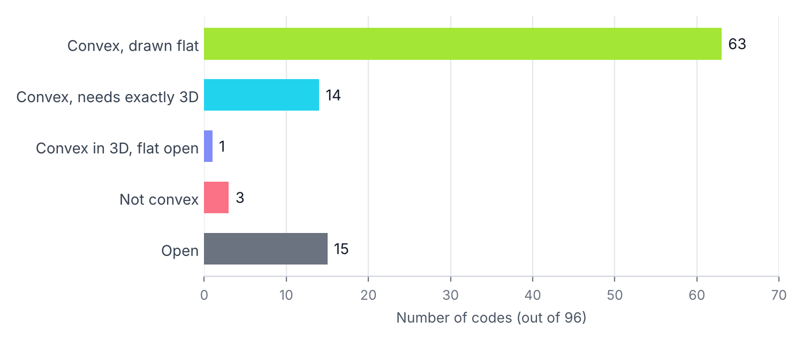

# The 96 Open Codes of Remark 2.33

**Interactive viewer:** https://notitsme.github.io/neural-codes-96/ (click through all 96 codes; the 3D ones spin)

Every time an animal walks through a room, a small group of neurons called place cells fires in a pattern, and each one fires only when the animal is inside its own patch of space, its place field. If you write down which neurons fire together, you get a neural code. The code is called convex when it can come from place fields that are convex (open regions with no dents or holes, like a disk or a polygon). The question is whether a given list of codewords can be drawn with convex regions at all, and for some small codes nobody knows the answer.

In 2025, Ahmed, Crepeau, Flores, Isekenegbe, Perez and Shiu pointed to 96 small codes (6 neurons, 5 maximal codewords each) whose convexity nobody knew (Remark 2.33 of [arXiv:2510.20323](https://arxiv.org/abs/2510.20323), from Table 1 of the wheels paper by Ruys de Perez, Matusevich and Shiu, [arXiv:2108.04995](https://arxiv.org/abs/2108.04995)). This repo settles 81 of them.



## What's here

| Result | Codes | How it's shown |
|---|---|---|
| Convex, drawn in the plane | 63 | explicit polygons (rectangles, octagons, or 16-sided polygons) |
| Convex, needs exactly 3D | 14 | not drawable in the plane (proof below) + explicit 3D polytopes |
| Convex in 3D, plane still open | 1 (C5-011) | explicit 3D polytopes |
| Not convex | 3 (C5-044, C5-047, C5-050) | first shown by P. Prabhakar (2026); reproduced here with two separate arguments |
| Open | 15 | everything we tried is listed per code in the viewer |

All 10 codes printed in Appendix A.1 of the wheels paper are among the solved ones (9 convex in the plane or in 3D, plus C5-011).

### Convex codes

Each drawing is a certificate: every region is written as a list of inequalities `lo < a·p < hi` with whole-number limits, so nothing depends on rounding. The checker below rebuilds the exact code each drawing makes and compares it with the target.

### Codes that need exactly 3D

For 14 codes, three of the regions only ever overlap inside one shared codeword (a "sunflower"), and the rest of the code forces any triangle connecting them to stay inside regions that never touch that shared part. Jeffs' sunflower theorem ([arXiv:1810.03741](https://arxiv.org/abs/1810.03741), Cor. 2.1) says a triangle with one corner in each of three such regions in the plane must contain a point of the shared part—so no flat drawing exists. Each of these 14 still has a 3D drawing, which makes 3 its exact minimum dimension, the same behavior Jeffs found for his code T3.

### Not convex

C5-044, C5-047 and C5-050 were first proven non-convex by Prayagh Prabhakar (S.-T. Yau High School Science Award, 2026) with his absorption criterion. We reimplemented that criterion independently, and his split-cover pinch argument gives a second, separate proof for all three.

## Verify it yourself

```
pip install z3-solver
python3 checker/verify.py            # checks all 78 drawings (a few minutes)
python3 checker/verify.py C5-068     # one code
```

For every set of neurons, the checker asks Z3 (exact rational arithmetic) whether some point lies inside exactly those regions. A drawing passes only if the codewords it produces match the target code exactly, with nothing missing and nothing extra. Editing a single region in a certificate makes it fail, which is how we tested the checker itself.

## Files

- `data/codes.json`: the 96 codes and their status
- `data/certificates/`: one file per convex code (`C5-xxx.json` octagons or rectangles in the plane, `_D8` 16-sided polygons, `_3D` polytopes)
- `checker/verify.py`: the exact checker
- `docs/`: the interactive viewer (served by GitHub Pages)

## Still open

Fifteen codes resist both drawing and every known non-convexity test (local obstructions, wheels, morphism images, absorption, split-cover). Six of them are proven not to fit in the plane. I'm working on a new kind of argument that could prove some of them non-convex.

Results fingerprint (Nov 7, 2026 bundle): `sha256 3bce792c2f3a20317ebd07bfb4aa7b0a29128851686689bd8930d6ba9c699c5f`

Zaid Mohammed
